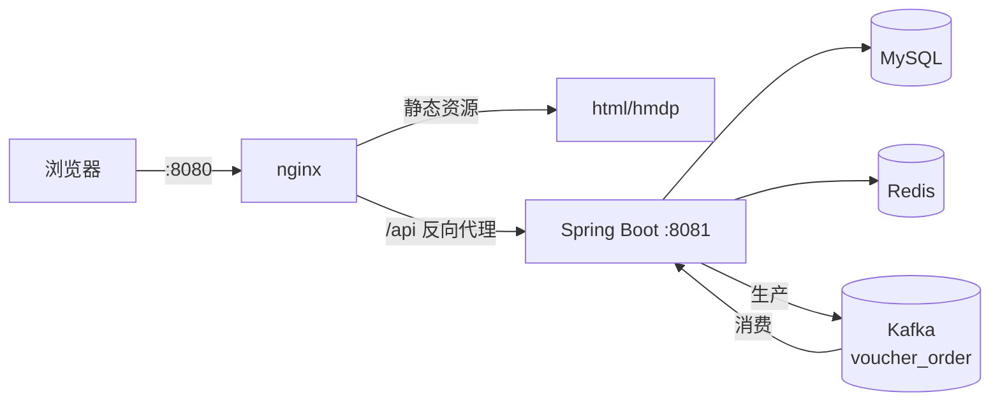
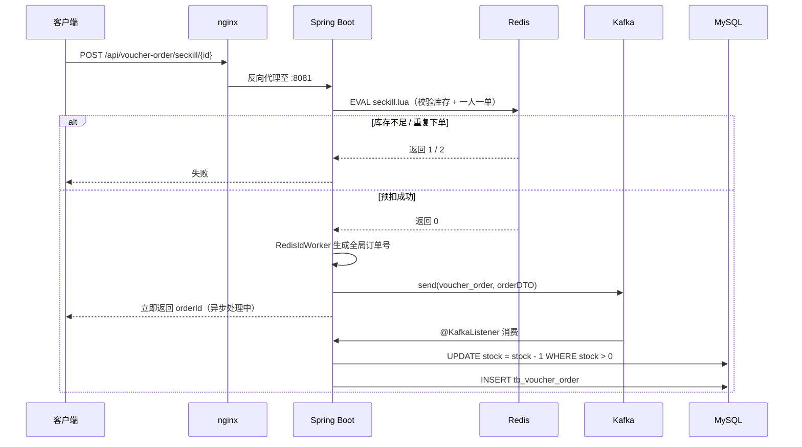

# 黑马点评（hm-dianping）

一个本地生活 / 点评类平台的后端实现：手机号登录、商户浏览与 GEO 附近搜索、达人探店博客、
点赞与关注 Feed 流、用户签到，以及基于 **Redis + Lua + Kafka** 的优惠券秒杀链路。

> 基于黑马程序员「黑马点评」课程项目二次开发。各部分的来源与本人工作见下方[归属说明](#项目来源与我的工作)。

---

## 项目来源与我的工作

| 部分 | 来源 | 说明 |
|---|---|---|
| 后端主体<br/>（登录、商户、博客、关注、缓存、GEO、签到、点赞、Feed） | 课程项目 | 跟随「黑马点评」课程实现 |
| **秒杀异步下单（Kafka）** | **本人扩展** | 新增 `KafkaConfig` / `KafkaConsumer` / `OrderDTO`，改造 `VoucherOrderServiceImpl`。课程原版不含 Kafka |
| 前端静态页面 | 课程配套资源 | 本人负责接口对接与 nginx 反向代理配置 |
| 接口文档 `docs/api/` | 本人整理 | 5 篇 Markdown |
| 仓库工程化 | 本人 | 目录整合、`.gitignore` 规则、种子数据整理 |

> 说明：本仓库是学习与技术演示用途，非生产系统。

---

## 技术栈

| 层次 | 技术 |
|---|---|
| 后端框架 | Spring Boot 2.3.12.RELEASE（Java 8） |
| 持久层 | MyBatis-Plus 3.4.3 + MySQL（mysql-connector-java 5.1.47） |
| 缓存 | Redis（spring-data-redis 2.6.2 + Lettuce 6.1.6）、Redisson 3.13.6 |
| 消息队列 | Kafka（spring-kafka），topic：`voucher_order` |
| 工具库 | Hutool 5.7.17、Lombok 1.18.30 |
| 前端 | 静态 HTML / CSS / JavaScript，nginx 提供服务并反向代理 `/api` |

**规模**：74 个 Java 文件 / 约 2900 行、9 个 Controller、11 张数据表、2 个 Lua 脚本、10 个前端页面。

---

## 系统架构



---

## 核心功能

| 模块 | 能力 | 关键技术 |
|---|---|---|
| 用户 | 手机号验证码登录、token 续期、登出、签到统计 | Redis Hash 存会话、BitMap 签到 |
| 商户 | 详情查询、分类分页、名称搜索、附近商铺 | 缓存穿透 / 击穿 / 逻辑过期、Redis GEO |
| 内容 | 探店博客发布、点赞、点赞排行榜、关注 Feed 流 | Redis ZSet、滚动分页 |
| 社交 | 关注 / 取关、共同关注 | Redis Set 交集 |
| 秒杀 | 优惠券秒杀下单 | Lua 原子预扣、Redis 全局 ID、Kafka 异步落库 |

---

## 秒杀链路设计



**设计要点**

- **原子性**：库存校验、重复下单校验、扣减库存三步在 `seckill.lua` 中一次完成，避免并发超卖
- **削峰**：请求在 Redis 层快速失败或通过，只有预扣成功的请求才进入 Kafka，数据库不会被打穿
- **全局 ID**：`RedisIdWorker` 用「时间戳 << 32 | 自增序列」生成订单号，避免分库分表下的 ID 冲突
- **异步解耦**：下单接口不等待落库，响应时间与数据库写入解耦

---

## 目录结构

```
DianPing/
 backend/                     Spring Boot 后端
    pom.xml
    src/main/
        java/com/hmdp/       controller / service / mapper / config / utils
        resources/           application.yaml、MyBatis XML、Lua 脚本、建表 SQL
 frontend/                    nginx 运行环境 + 页面代码
    conf/nginx.conf          静态资源 + /api 反向代理
    html/hmdp/               页面（html / css / js / imgs）
 docs/api/                    接口文档（Markdown，5 篇）
 others/                      素材与数据库脚本
 README.md
```

---

## 快速开始

**前置**：JDK 8+、Maven、MySQL、Redis、Kafka、nginx

1. **初始化数据库**
   导入 `backend/src/main/resources/db/hmdp.sql`，数据库名 `hmdp`。

2. **启动依赖服务**
   MySQL `3306`、Redis `6379`、Kafka `9092`。

3. **配置本机数据库密码（重要）**

   `application-local.yaml` 不纳入版本控制。新环境先从模板复制：

   ```powershell
   Copy-Item backend\src\main\resources\application-local.yaml.example `
             backend\src\main\resources\application-local.yaml
   ```

   `application.yaml` 默认激活 `local` 环境，可用环境变量 `SPRING_PROFILES_ACTIVE` 覆盖。

4. **启动后端**
   运行 `com.hmdp.HmDianPingApplication`，端口 `8081`。

5. **启动前端**
   在 `frontend/` 目录下启动 nginx（端口 `8080`），访问 http://localhost:8080 。
   页面请求的 `/api` 由 nginx 反向代理到后端 `8081`。

---

## 接口文档

见 [`docs/api/`](docs/api/)。

---

## 注意事项

- **图片上传目录**：默认从当前工作目录逐级向上查找 `frontend/html/hmdp/imgs`，
  因此从 `backend/` 或仓库根目录启动都能正确定位。换机器或部署时可用环境变量
  `HMDP_UPLOAD_DIR`（或配置项 `hmdp.upload.dir`）指定绝对路径。实现见
  `backend/src/main/java/com/hmdp/config/UploadProperties.java`。
- **不要提交密码**：`application-local.yaml`、`*.env` 等已在 `.gitignore` 中忽略。
- `frontend/html/hmdp/imgs/blogs/` 下仅有 `hmdp.sql` 引用的 13 张种子图入库，
  运行期上传的图片不入库。

---

## 后续计划

- [ ] 秒杀消费端幂等（唯一索引 + 幂等表）、失败重试与死信队列
- [ ] 补全接口鉴权覆盖，修复图片删除接口的路径校验
- [ ] 引入 Testcontainers 集成测试（秒杀并发、缓存击穿、鉴权）
- [ ] Docker Compose 一键启动 MySQL / Redis / Kafka / nginx
- [ ] 升级至 Spring Boot 3.x / Java 21
- [ ] 接入 SpringDoc 自动生成接口文档

---

## 致谢

- 课程与前端静态资源：[黑马程序员「黑马点评」](https://www.itheima.com/)
- 前端页面仓库：[huyi612/hmdp-web](https://gitee.com/huyi612/hmdp-web)
